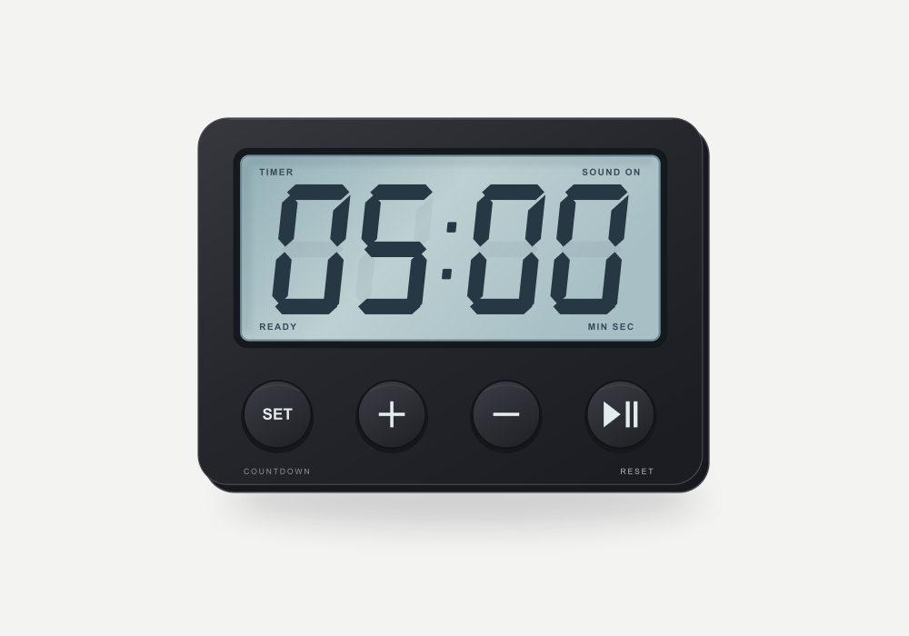

# Slide Timer for PowerPoint on Mac

A countdown timer that lives **on your slide**. Insert it once, then start, pause, adjust and reset it with clicks during the slide show. At zero it shows **TIME'S UP** and plays an alert sound.
It is a single VBA module. You don't install an add-in and it doesn't need a network connection. The timer is built from ordinary PowerPoint shapes, so it travels with your `.pptm` file.

## Features

- **LCD look:** slanted seven-segment digits drawn as native shapes, so no special font is needed.
- **Click controls in Slide Show view:** play/pause, SET presets, +/− one minute, reset, and sound on/off.
- **Accurate timing:** the time is calculated from a monotonic clock and a deadline, so the countdown doesn't drift.
- **End alert:** the macOS *Hero* sound plays three times at zero, at your system alert volume. You can turn it off per timer.
- **Durations from 1 second to 23:59:59.** An hours field appears automatically for timers of one hour or more.
- **One timer per slide.** Each slide stores its own duration and sound setting.
- **Gets out of your way.** The macro only runs while the countdown is running. Pause it, or let it finish, and Esc and slide navigation work normally again. Play resumes where you paused.
- **Offline and self-contained:** no telemetry, network calls, AppleScript or third-party code.

## Requirements

- Desktop **PowerPoint for Mac** (Microsoft 365 / Office 2019 or later, 64-bit, VBA7)
- Presentation saved as a **macro-enabled presentation (`.pptm`)**
- Macros allowed for that presentation. Some organization policies block them.

The timer does not run in PowerPoint for Windows, PowerPoint on the web, iPad/iPhone, Keynote, or in exported PDFs or videos. The module uses macOS system libraries.

## Setup

1. **Download** [`SlideTimer.bas`](SlideTimer.bas) from this repository.
2. Open your presentation in PowerPoint for Mac. Choose **File > Save As** and select **PowerPoint Macro-Enabled Presentation (.pptm)**.
3. Open **Tools > Macro > Visual Basic Editor**. If the project list is hidden, choose **View > Project Explorer**, then select your presentation's project.
4. Choose **File > Import File…** and pick `SlideTimer.bas`. A module named **SlideTimer** appears. Import it only once per presentation.
   - If *Import File* is unavailable, choose **Insert > Module** and paste the full contents of [`SlideTimer-Paste.txt`](SlideTimer-Paste.txt). This is the same code without the import-only `Attribute` line.
5. Back in PowerPoint, select a slide in **Normal** view. Choose **Tools > Macro > Macros…**, run **`Timer_Insert`**, and enter a duration (for example `5` or `1:30`).
6. Save the file. Start the show (**Slide Show > From Current Slide**) and click the round **play/pause** button.

When PowerPoint asks about macros on opening the file, enable them. Without macros the timer is only a picture.

**Optional checks before presenting:** run `Timer_RunSelfTests` (expect *30 checks passed*), `Timer_TestSound` (plays the end alert), and a short `0:05` countdown in Slide Show view on your real display setup.

## Using the timer

### In Slide Show view

| Control | What it does |
| --- | --- |
| **Play/pause** (or click the digits) | Start, pause or resume. Pausing also releases the show for Esc and navigation. After TIME'S UP it starts a new countdown. |
| **SET** | Step to the next preset: 1, 2, 3, 5, 10, 15, 20, 30, 45, 60 minutes, then back to 1. Resets the timer. |
| **+** / **−** | Add or subtract one minute. Works while running or paused, with a minimum of 1 second. |
| **RESET** | Restore the configured duration and wait for play. |
| **SOUND ON / OFF** | Turn the end alert on or off for this timer. |

**Need to leave mid-countdown?** Press pause, then Esc or the arrow keys as usual.

At zero the digits turn muted red, the display shows **00:00 / TIME'S UP**, and the alert plays (if sound is on). Clicking reset, play or SOUND OFF during the alert stops the remaining repeats.

SET uses presets instead of a text field during the show because PowerPoint for Mac opens dialogs behind the full-screen show, where they cannot receive input. To set an exact duration such as `7:30`, use `Timer_Configure` in Normal view.

### In Normal view

Run these from **Tools > Macro > Macros…**:

| Macro | Purpose |
| --- | --- |
| `Timer_Insert` | Add a timer to the current slide (or edit the duration if one exists) |
| `Timer_Configure` | Type any duration for the current slide's timer |
| `Timer_Remove` | Delete the current slide's timer |
| `Timer_RefreshStyle` | Rebuild the timer with the current design, keeping duration, sound, position and width |
| `Timer_CheckCurrent` | Check that all timer parts are present |
| `Timer_TestSound` | Play the end alert |
| `Timer_RunSelfTests` | Check parsing, formatting and the native clock bindings |
| `Timer_Help` | Show a short help dialog |

Duration input accepts:

| Input | Duration |
| --- | --- |
| `5` | 5 minutes |
| `1:30` | 1 minute 30 seconds |
| `0:10` | 10 seconds |
| `1:02:03` | 1 hour 2 minutes 3 seconds |

Whole numbers only. The range is `0:01` to `23:59:59`.

### Placing and reusing timers

- Move or resize the timer as **one group** in Normal view. Don't ungroup it or rename its parts.
- Duplicate a timer slide, or run `Timer_Insert` on another slide. Each slide keeps its own settings.
- To use the timer in another presentation, import the module there too. Copying the shapes alone does not copy the code.
- If the slide has a **transition**, set it to **None**. The timer redraws the slide once per second, and a transition would replay each time.

## Customization

The settings are constants at the top of `SlideTimer.bas`:

| Constant | Default | Meaning |
| --- | --- | --- |
| `PT_ALERT_FILE` | `/System/Library/Sounds/Hero.aiff` | Sound played at zero. Any `.aiff`, `.wav` or `.caf` path works. Try `Glass`, `Ping` or `Submarine` from the same folder. |
| `PT_ALERT_REPEATS` | `3` | How many times the alert plays |
| `PT_ALERT_GAP` | `1.2` | Seconds between alerts |

The SET presets are in `NextPresetDuration`. If the sound file can't be loaded, the timer falls back to the alert sound selected in **System Settings > Sound**.

## How it works

- The timer is a single PowerPoint group of about 65 shapes. Each digit has seven polygon segments, and each button has an *Action Setting* that runs a public VBA macro.
- `CACurrentMediaTime` (QuartzCore) provides a monotonic clock. The remaining time is calculated from a deadline, not by counting ticks.
- A loop with `DoEvents` and a 30 ms `usleep` keeps the controls responsive without spinning the CPU. A guard prevents a second loop from starting.
- Each second, only the segments that change are updated. PowerPoint for Mac doesn't repaint a running show after changes made from VBA, so the timer re-enters the current slide (`GotoSlide …, msoFalse`) to force a redraw.
- The end alert loads the sound with `AudioServicesCreateSystemSoundID` and plays it with `AudioServicesPlayAlertSound` (AudioToolbox), because VBA's `Beep` is silent on Mac.
- Settings are stored as shape tags on the timer. There are no external configuration files.

## Known limitations

- Leaving the slide or ending the show while the timer *runs* resets it. The countdown doesn't follow you across slides.
- A paused or finished timer keeps its display (PAUSED or TIME'S UP), also when you come back to the slide or end the show. Press RESET to return to the configured duration. Because PowerPoint keeps shape changes made during a show, save the file after a reset if you want it to open in the Ready state.
- While a countdown is running, the VBA loop is active, and PowerPoint may react to keyboard navigation more slowly than usual. Pause first for instant navigation.
- PowerPoint for Mac offers VBA no way to add keyboard shortcuts inside a slide show, so pause is the way to release the timer.
- Only one slide show at a time and one timer per slide are supported.
- Don't let the Mac sleep during a countdown.

## Troubleshooting

**Clicking play does nothing.** Make sure you are in Slide Show view, macros are enabled, and the module is in *this* presentation. With Presenter View, click on the audience display.

**The digits only change when I click.** You are running an old version of the module. Replace it with the current `SlideTimer.bas`.

**No sound at zero.** Check that the timer shows SOUND ON, run `Timer_TestSound`, and check the alert volume and output device in **System Settings > Sound**.

**The macros disappeared.** The file was saved as `.pptx`, which removes VBA. Import the module again and save as `.pptm`.

**"Missing timer component …" or a control lost its action.** Run `Timer_RefreshStyle` in Normal view to rebuild the timer, or delete it and run `Timer_Insert`. To fix one control by hand, use **Insert > Action > Run macro** with these macros: play/pause and digits use `Timer_Toggle`, RESET uses `Timer_Reset`, SET uses `Timer_Configure`, + uses `Timer_AddMinute`, − uses `Timer_SubtractMinute`, and SOUND uses `Timer_ToggleSound`.

## Updating

Exit the slide show. In the Visual Basic Editor, remove the old **SlideTimer** module (**File > Remove SlideTimer**, then *No* to export). Import the new `SlideTimer.bas` and save as `.pptm`. Existing timers on your slides can stay. Run `Timer_RefreshStyle` only if `Timer_CheckCurrent` reports a problem.

## Browser preview

[`START-HERE.html`](START-HERE.html) is a JavaScript mock-up of the timer that you can open in any browser to try the controls. It is a demonstration only. It uses a synthesized chime and says nothing about PowerPoint compatibility.

## Changelog

- **1.1.9:** Pausing ends the macro, so Esc and navigation work while paused. Play resumes the remaining time, and +/− adjust it.
- **1.1.8:** SET steps through presets during the show (the dialog was unreachable). The macro releases the slide show after the finish alert, and the redraw no longer pulls you back after you navigate away.
- **1.1.7:** The end alert is the macOS Hero sound, played three times.
- **1.1.6:** The end alert plays through macOS AudioToolbox instead of the silent VBA `Beep`.
- **1.1.5:** The display redraws every second during the show instead of only on clicks.
- **1.1.3:** Faster renderer: cached shapes, and only changed segments are updated.
- **1.1.2:** Flat LCD group layout and `Timer_RefreshStyle` migration.

## License

[MIT](LICENSE) © 2026 Pascal Weissleder
