# Set up Slide Timer

[← Back to the overview](../README.md)

You set this up **once in each presentation**. After that, open the presentation and start your slide show normally. The screenshots below show a real PowerPoint for Mac setup; your presentation’s name will be different.

You need desktop PowerPoint on a Mac. This version does not run in PowerPoint for Windows, a web browser, Keynote, or an exported PDF/video.

## 1. Get the files

[Download the setup ZIP](../downloads/SlideTimer-Mac.zip?raw=true) and double-click it to extract the folder. Open **START-HERE.html** if you want the illustrated timer preview beside the instructions.

Inside the **powerpoint** folder you will find two files. You need both:

| File | What it does |
| --- | --- |
| `SlideTimer.bas` | Creates the timer and its controls |
| `SlideTimerEvents.cls` | Stops the timer’s background work safely when you close the presentation |

The different endings are normal. You do not need to open or edit either file.

## 2. Save your presentation in the right format

In PowerPoint, choose **File → Save As**. Select **PowerPoint Macro-Enabled Presentation (.pptm)** as the format, then save.

The `.pptm` ending matters: it keeps the timer’s code. Saving as `.pptx` removes it. Choose the **File Format** shown below, rather than only typing a different filename ending.

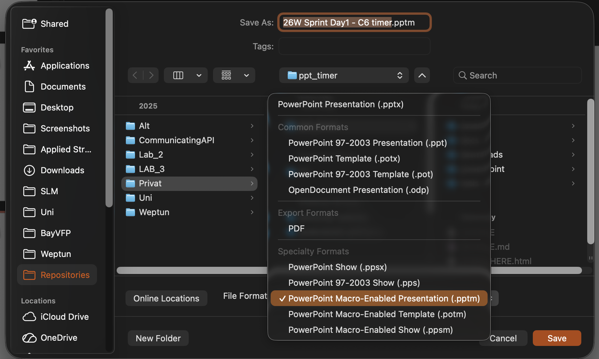

*Select PowerPoint Macro-Enabled Presentation (.pptm), then click Save.*

## 3. Add both files to PowerPoint

### Open the Visual Basic Editor

Choose **Tools → Macro → Visual Basic Editor** from the Mac menu bar.

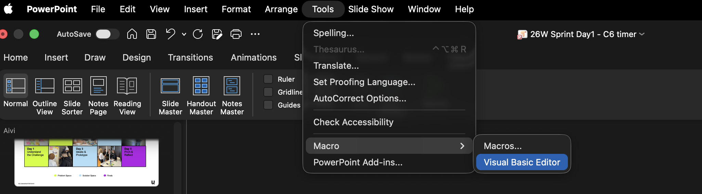

*Use the Mac menu bar at the top of the screen.*

### Import SlideTimer.bas

In the list on the left, find your presentation. If the list is missing, choose **View → Project Explorer**. Right-click your presentation’s **VBAProject** entry and choose **Import File…**. You can also use **File → Import File…** if it is available.

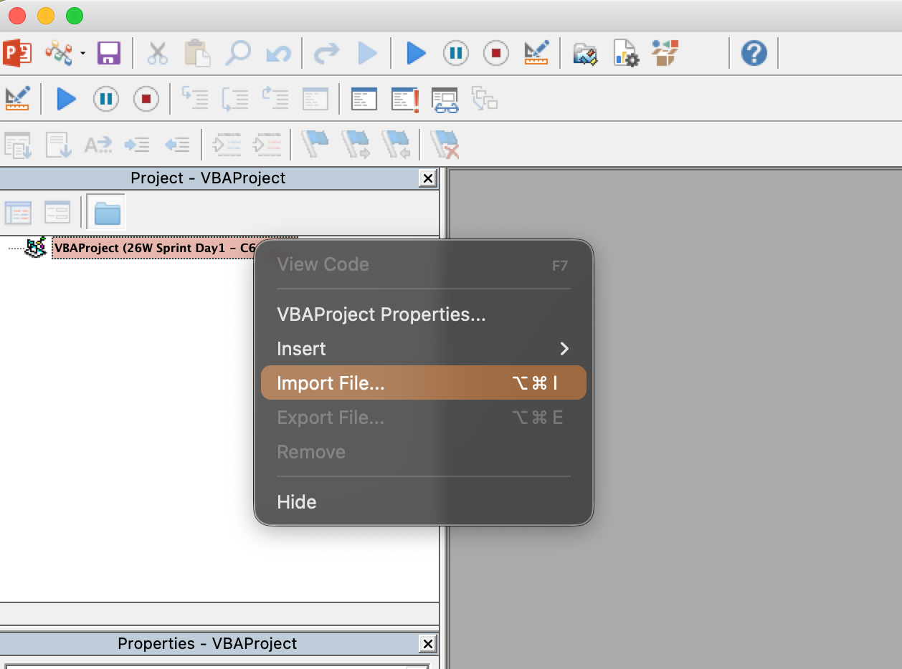

*Right-click your own presentation in the left pane. The example presentation name is only an illustration.*

Open the package’s **powerpoint** folder, select **SlideTimer.bas**, then click **Open**.

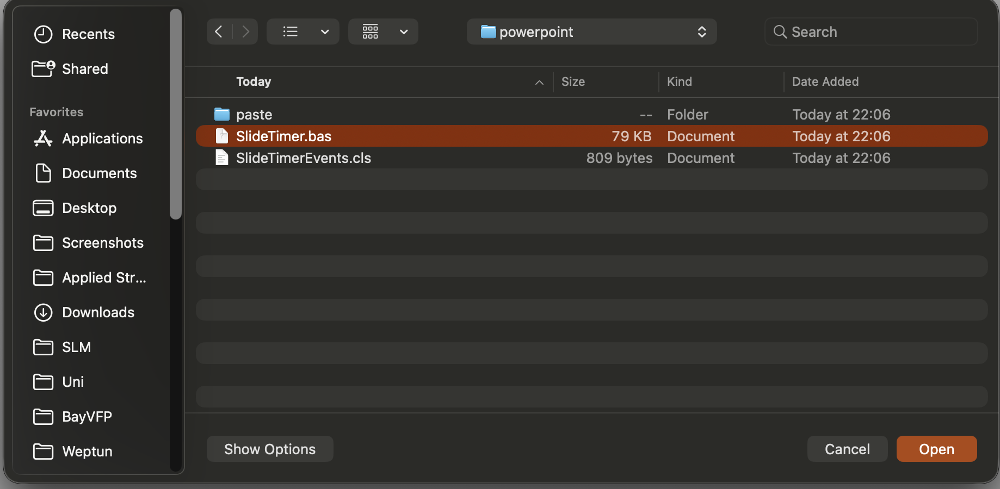

### Import SlideTimerEvents.cls

Right-click the same project and choose **Import File…** again. This time select **SlideTimerEvents.cls** and click **Open**.

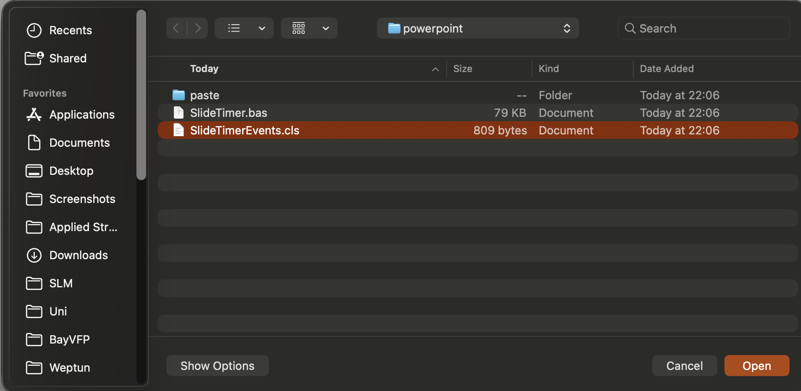

*Repeat the import for the second file; importing only SlideTimer.bas is not enough.*

### Check that both files are in place

Your project should now contain these two entries:

- **Modules → SlideTimer**
- **Class Modules → SlideTimerEvents**

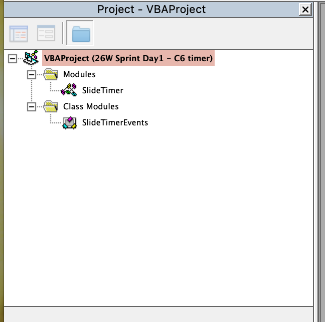

*This is the finished import. You do not need to open or edit the code.*

Return to the main PowerPoint window. Import each file only once into this presentation. If you are replacing an older version, use the [update guide](UPDATING.md).

If PowerPoint asks whether to allow macros for this presentation, allow them so the timer can run.

## 4. Pick the slide

Select a slide in PowerPoint’s **Normal** editing view.

**Tip: duplicate your Action slide first.** Use the original to explain the activity. Right-click its thumbnail on the left and choose **Duplicate Slide**. Put the timer on that copy, so the instructions remain visible when the timed activity begins.

Set the copy’s slide transition to **None**. This prevents the transition from replaying when the timer refreshes.

## 5. Create the timer

### Open the Macros window

Choose **Tools → Macro → Macros…**. You can also use **View → Macros** in the ribbon, as shown here. Keep the slide where you want the timer selected.

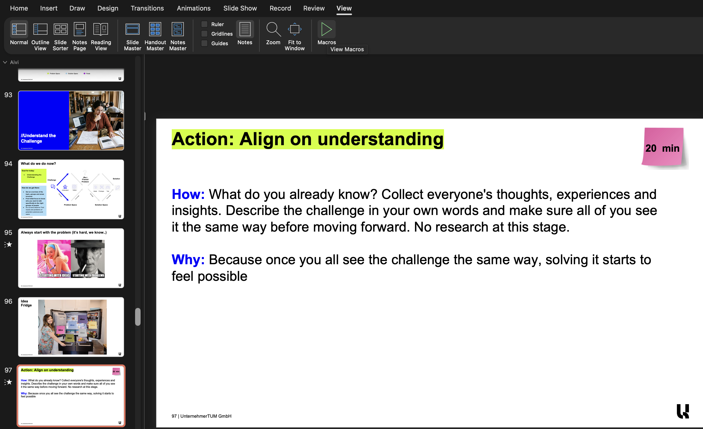

Select **Timer_Insert**, then click **Run**. If several presentations are open, choose this presentation in **Macros in** first.

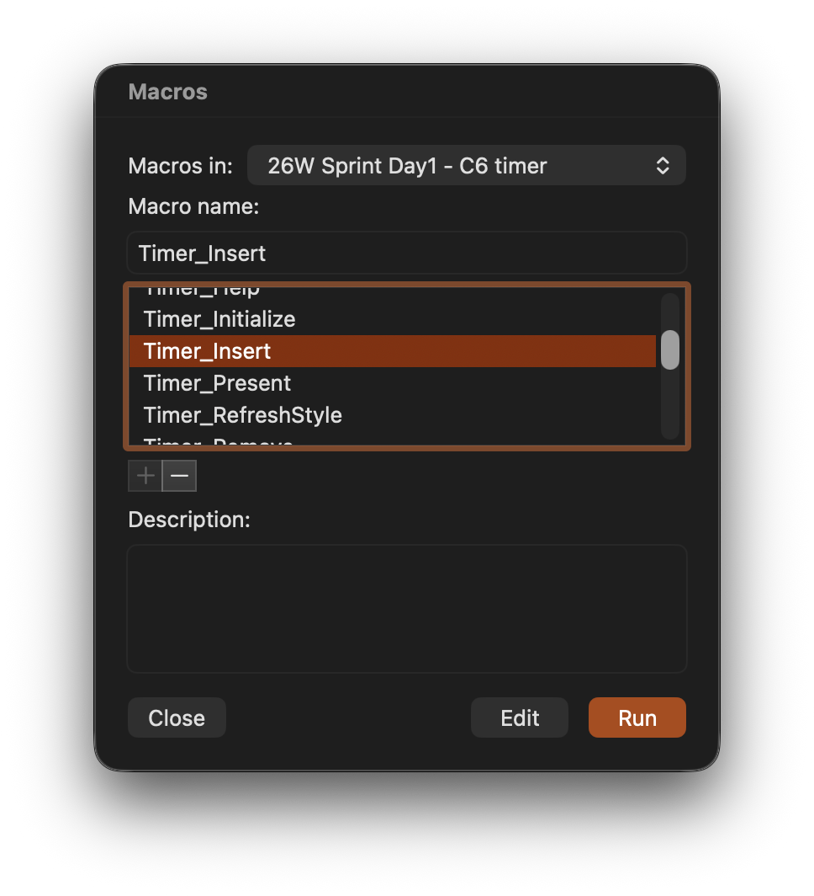

*For a new timer, use Timer_Insert. Timer_Initialize is only for cleaning up older versions during an update.*

### Enter the duration

Enter the time you want and click **OK**. For example, `3` means three minutes, `1:30` means ninety seconds, and the `05:00` shown below means five minutes.

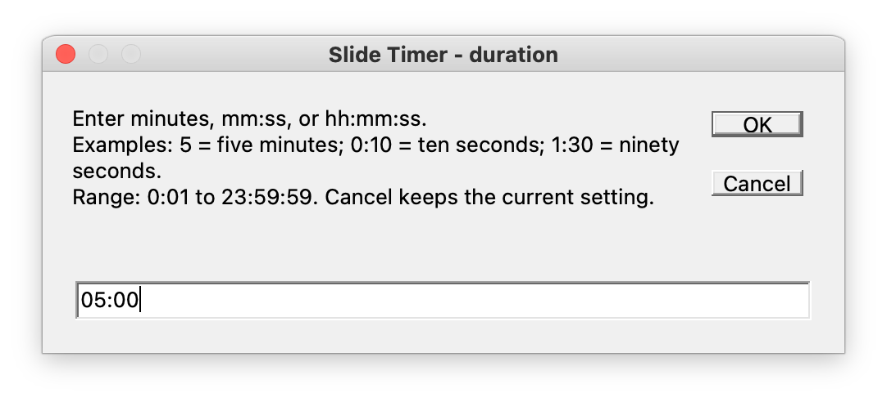

### Choose an end sound

Choose a listed number or name and click **OK**. For example, enter `2` or `Glass`. Enter `0` for no sound.

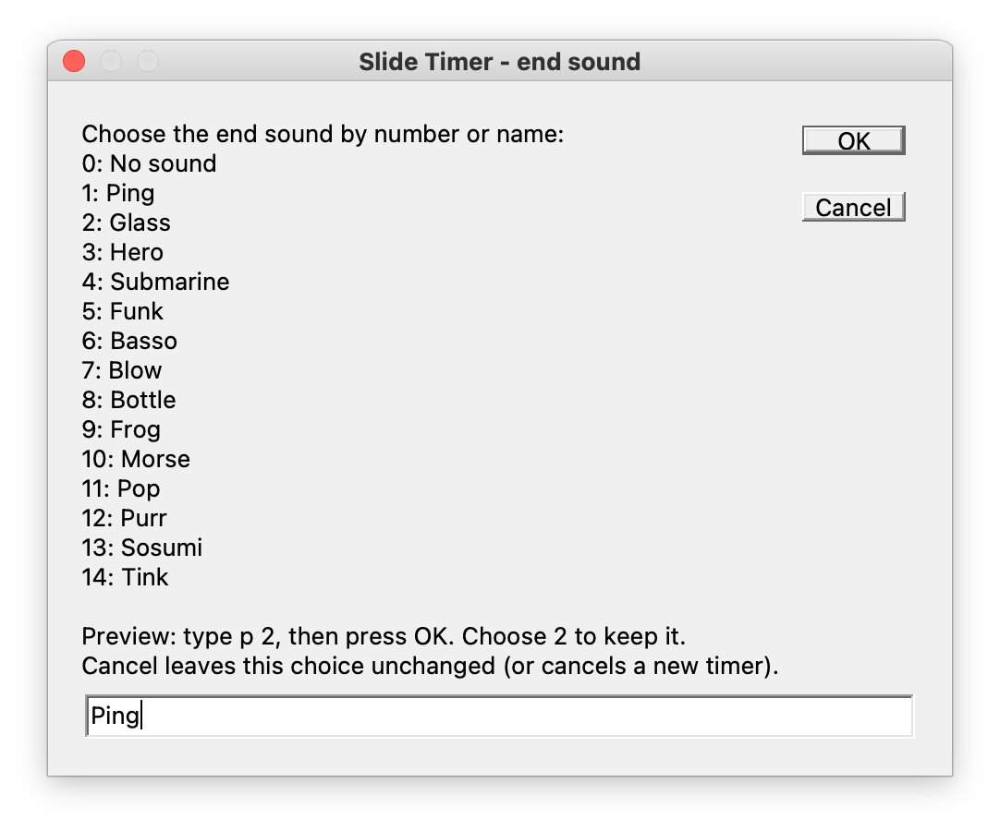

To listen first, enter **p 2** and click **OK** to preview Glass. The chooser returns; then enter **2** or **Glass** and click **OK** to keep it. Previewing alone does not save the choice.

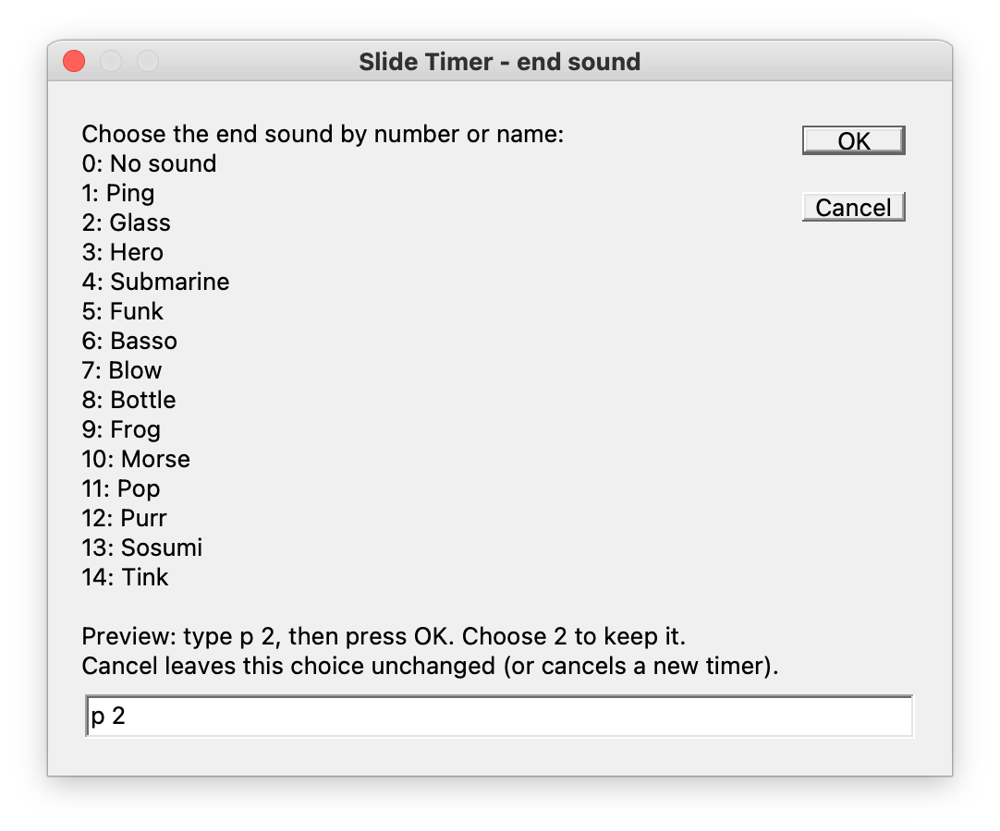

Save the presentation. Canceling either creation prompt leaves the slide without a new timer.

## 6. Make it fit your slide

Click the timer’s outer edge to select the **whole timer group**. Drag it to position it, and drag a **corner handle** to resize it. Make it as large or small as you like for your layout. Keep all the parts grouped; you do not need to resize individual digits or buttons.

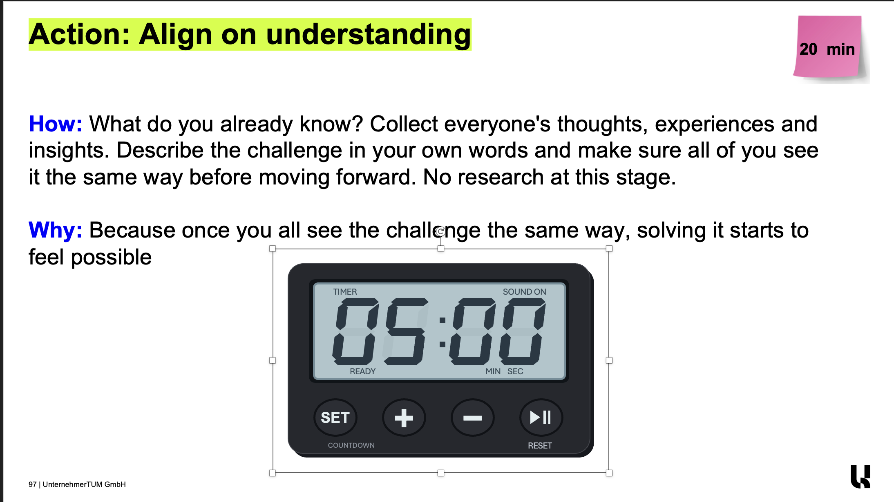

*The handles surround the complete timer. Drag a corner to fit it below or beside your instructions, then drag the group into position. Set the duration to match your own activity.*

## 7. Try it

Start the show using PowerPoint’s usual **Slide Show** commands. Click the timer’s **play/pause button or digits** to start. Click again to pause or resume.

No startup macro is needed each time you present. Test a short countdown and the end sound on the display and speakers you plan to use.

## If Import File is unavailable

You can paste the same code instead. The **powerpoint/paste** folder contains two text files prepared for this route.

1. In the Visual Basic Editor, select your presentation and choose **Insert → Module**.
2. Open **SlideTimer-Paste.txt**, copy its entire contents, and paste them into that new module’s code window. In the Properties window, set its **(Name)** to **SlideTimer**. If Properties is hidden, use **View → Properties Window**.
3. Choose **Insert → Class Module**. This is a different menu item from Module.
4. In its Properties window, set **(Name)** to exactly **SlideTimerEvents**.
5. Open **SlideTimerEvents-Paste.txt** and paste its entire contents into that class module.
6. Return to PowerPoint and continue with step 4 above.

Use this route instead of importing the files; doing both creates duplicate code.

## Ready for another presentation?

Repeat the two-file setup in that presentation, then run **Timer_Insert** on the slide you want. Copying a timer from another deck copies its appearance, but does not copy the code.

[Using the timer →](USING.md) · [Something not working?](TROUBLESHOOTING.md)
