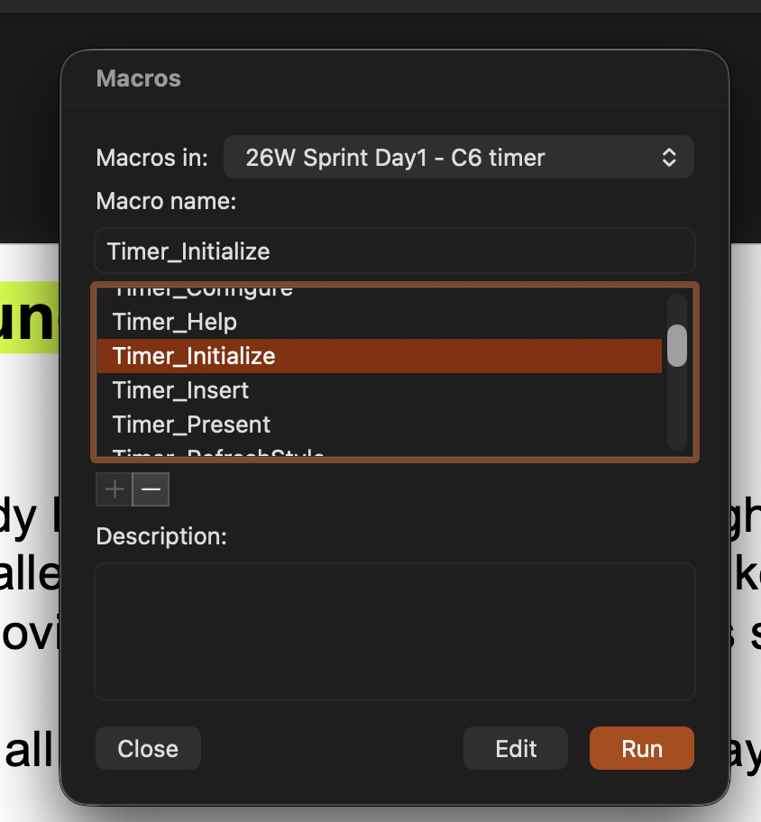

# Update an existing presentation

[← Back to the overview](../README.md)

You can keep your existing timer groups on the slides. Replace **both code files** so they match. Their duration, sound choice, size and position can stay.

## Before you begin

Save a backup of your presentation and download/extract the [current setup ZIP](../downloads/SlideTimer-Mac.zip?raw=true).

- **Using 1.2.2 or later:** run **Timer_Shutdown**, then exit the show before changing the code.
- **Using 1.2.0 or 1.2.1 after a sound failure/crash:** quit and reopen PowerPoint first. Do not run the old sound test or shutdown macro; they use the old sound bridge.
- **Using 1.1.x:** pause the timer and exit the show.

If you are unsure which version you have, restart PowerPoint before replacing the files and do not start an old timer first.

## Replace the files

1. Open **Tools → Macro → Visual Basic Editor** and select this presentation on the left.
2. Remove the old **SlideTimer** module. If asked to export it, you can decline if you already made a backup.
3. Remove **SlideTimerEvents** too, if it is present.
4. Right-click your presentation’s project entry and choose **Import File…** to import both files from the new package’s **powerpoint** folder: **SlideTimer.bas** and **SlideTimerEvents.cls**. **File → Import File…** is another option if available.
5. Return to PowerPoint’s normal editing view.
6. Run **Timer_Initialize once**, then save as **.pptm**. This removes hidden click-start shapes and animation steps from 1.2.0–1.2.3; it does not add new ones.
7. Start the show normally and try the timer’s play/pause button or digits. Check the selected sound with **Timer_TestSound**.

## Only when updating an older timer

The screenshot below shows **Timer_Initialize** selected. Use this once to clean up an existing deck from 1.2.0–1.2.3 after replacing its code, as described in step 6 above.

**This is not the command for creating a new timer or starting every show.** Use **Timer_Insert** to create a timer; start later shows normally.

If Import File is unavailable, use the [paste alternative](SETUP.md#if-import-file-is-unavailable) after removing the old modules.

You do not need to run an initialization macro before later shows. Use **Timer_RefreshStyle** only if a timer uses an older layout or reports missing components.

[See what changed →](CHANGELOG.md)
