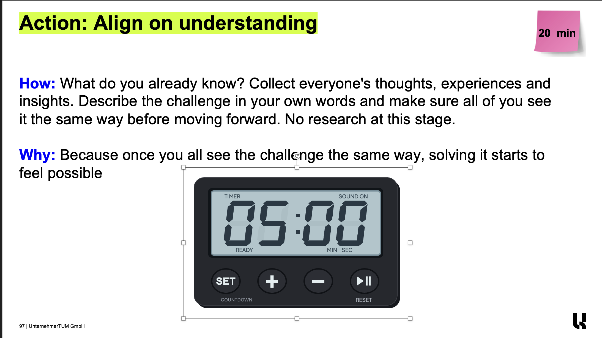
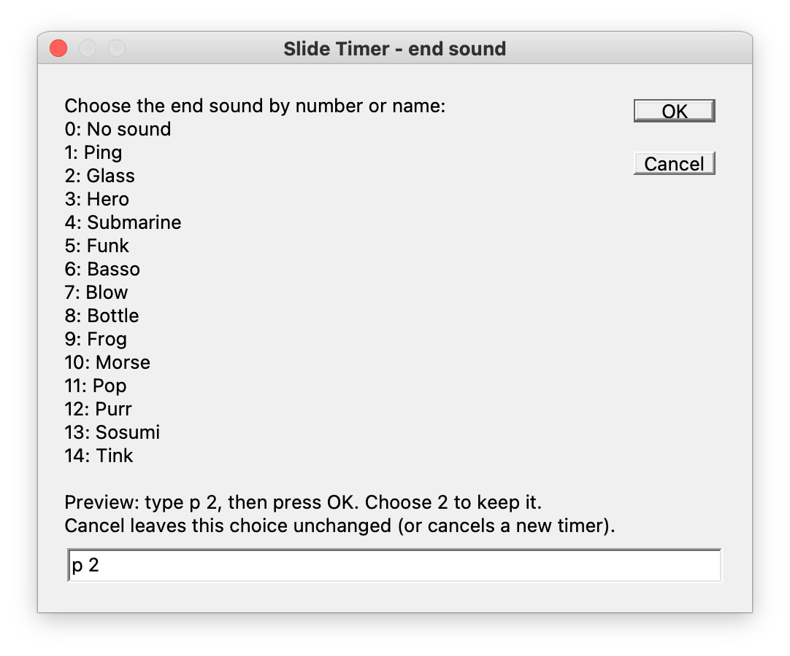

# Use your timer

[← Back to the overview](../README.md)

## During the slide show

Start PowerPoint’s slide show normally. Click the timer’s **play/pause button or digits** to start, pause or resume. The remote, spacebar and arrow keys keep their normal slide-navigation behavior.

| Control | What happens |
| --- | --- |
| Play/pause or digits | Start, pause or resume. After TIME’S UP, start a fresh countdown. |
| SET | Choose the next preset: 1, 2, 3, 5, 10, 15, 20, 30, 45 or 60 minutes. It then returns to 1. Waits for play. |
| + / − | Add or subtract one minute while running or paused; the minimum is one second. |
| RESET | Restore the configured duration and wait for play. |
| SOUND ON / OFF | Enable or mute this timer’s end sound. |

At zero, the digits turn muted red and the timer shows **TIME’S UP**. If sound is on, your chosen sound plays three times. Reset, restart or mute cancels the remaining repeats; a sound already playing can finish.

## Use a copy of the Action slide

For an activity, keep two slides next to each other:

| Slide | When to show it |
| --- | --- |
| Original Action slide | Explain the activity and answer questions. |
| Copy of the same Action slide, with the timer added | Start the timed activity while participants can still read the instructions. |

In editing view, right-click the original slide’s thumbnail and choose **Duplicate Slide**. Select the copy, run **Timer_Insert**, and place the timer in the free space below or beside the instructions. Advance to that copy when the activity begins, then click play.

Use **None** as the timer slide’s transition so it does not replay on each timer refresh.

## Resize and position it freely

You can make the timer **larger or smaller to suit your slide**. In editing view, select the whole timer group, drag a corner handle to resize it, and drag the group to move it. A small timer beneath the activity instructions keeps them readable; a larger timer is easier to see from farther away.

*Select the whole timer, then use its corner handles. The example is in editing view; start the show normally when you are ready to use it.*

Keep its parts grouped and their names intact so the controls keep working. There is no need to resize or move the digits separately.

To reuse the layout, duplicate the timer slide. Each copy keeps its own duration and sound choice. You can also run **Timer_Insert** on another slide.

## Set an exact duration

In editing view, select the timer’s slide and run **Timer_Configure** from **Tools → Macro → Macros…**.

| Enter | You get |
| --- | --- |
| `3` | 3 minutes |
| `1:30` | 1 minute 30 seconds |
| `0:10` | 10 seconds |
| `1:02:03` | 1 hour 2 minutes 3 seconds |

Use whole numbers between `0:01` and `23:59:59`. During the show, SET uses presets rather than a typing dialog.

## Choose or preview a sound

Select the timer’s slide in editing view, then run **Timer_ChooseSound**. Choose by number or name:

1. Ping
2. Glass
3. Hero
4. Submarine
5. Funk
6. Basso
7. Blow
8. Bottle
9. Frog
10. Morse
11. Pop
12. Purr
13. Sosumi
14. Tink

Enter **0**, **None** or **Off** for a silent timer. Enter **p 2** to preview Glass, then **2** or **Glass** to save it. Previewing does not save a choice; Cancel keeps the previous setting. Each timer saves its own sound with the presentation.

SOUND ON can re-enable the previous sound after muting. A timer created with no sound uses Ping if you later turn sound on.

The sound follows **System Settings → Sound → Output** and your Mac’s media volume. Select your external speakers, HDMI display, Bluetooth device or audio interface there. To check it before presenting, run **Timer_TestSound** on the timer’s slide. A muted timer stays silent.

## Move between slides or apps

A running timer keeps counting when you change slides, switch apps, or press Esc to leave the show briefly. Returning to it preserves its running, paused or finished state. It can play its end sound while you are on another slide or in editing view.

Pause it if you want counting to stop. Closing the presentation ends its timer session; reopening does not restore a running countdown. Keep the Mac awake while it runs.

## Finish your rehearsal

Press RESET if you want the saved slide to show its full duration, then save. PowerPoint can keep timer appearance changes made during the show, so a slide saved after a rehearsal may otherwise still show PAUSED or TIME’S UP.

[Help with a problem →](TROUBLESHOOTING.md)
